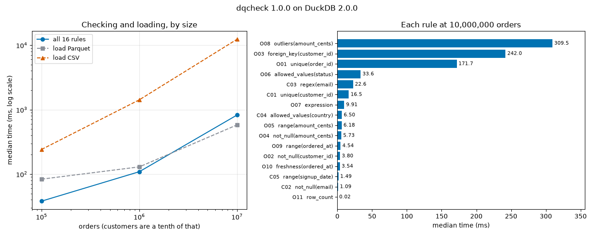

# dqcheck: data quality rules in YAML, run as SQL on DuckDB

[](https://github.com/TexAlphaWolf/ana-data-quality-checks/actions/workflows/ci.yml)
[](https://github.com/TexAlphaWolf/ana-data-quality-checks/actions/workflows/codeql.yml)


You describe what your CSV or Parquet files must satisfy in a YAML file (ten rule types: not null, unique, range, allowed
values, regex, foreign key, outliers, SQL expression, row count, freshness). `dqcheck` runs every rule as a query on
DuckDB and reports **how many rows break it and which ones**, with the row's position in the file. It exits 0, 1 or 2, so
it fits in a CI job.

What makes it more than a script: it ships a **data generator that injects faults in known numbers** (eleven kinds, on
disjoint rows) and writes a `manifest.json` saying which rule must find how many. The tests, and the benchmark itself,
check every count against that manifest and against an independent pure-Python implementation.



## What the numbers say

All figures are from one run in Docker on Linux x86_64 with 12 threads, Python 3.14.10 and DuckDB 2.0.0
([`docs/bench.json`](docs/bench.json); seed 1, 1% of the rows damaged; median of 5 runs; 87.4 s in total).

1. **The whole rule set (16 rules, two datasets) takes 38.1 ms on 100,000 orders and 825.9 ms on 10,000,000**: 100 times
   the data costs 21.7 times the time, which is 13,318,365 rows per second at the top.
2. **Reading the file costs more than checking it, and CSV costs much more than Parquet.** At 10 million orders, loading
   the Parquet takes 580 ms, loading the CSV 12,361 ms (21 times more, and 15 times the time of all the rules). The CSV is
   also 2.3 times larger (593.0 MiB against 253.9 MiB).
3. **Three rules are most of the work.** At 10 million orders `outliers` (309.5 ms), `foreign_key` (242.0 ms) and
   `unique` on the order id (171.7 ms) make 86% of the time; a null check is 3.8 ms.
4. **Every count matched the manifest at every size**, including 200,000 rows on the duplicated ids at 10 million orders.

[`docs/analysis.md`](docs/analysis.md) goes through the results and their limits; [`docs/bench.md`](docs/bench.md) is the
generated report.

## Quick start

With Docker (nothing else to install):

```bash
docker build -t dqcheck .
docker volume create dq
docker run --rm --user 0 -v dq:/data --entrypoint chown dqcheck 10001 /data
RUN="docker run --rm --read-only --tmpfs /tmp --cap-drop ALL --security-opt no-new-privileges --network none -v dq:/data dqcheck"
$RUN generate --rows 10000 --out /data/demo      # data with faults, rules.yml and manifest.json
$RUN run /data/demo/rules.yml --sample 2         # exit 1: some rules fail
```

With Python 3.11 to 3.14:

```bash
pip install .
dqcheck generate --rows 10000 --out demo
dqcheck run demo/rules.yml --sample 2
```

## The rules file

```yaml
as_of: '2026-01-01'              # "today" for freshness, so a run is reproducible
datasets:
  customers: customers.parquet   # .parquet or .csv; relative to this file
  orders: orders.parquet
rules:
- id: C03
  dataset: customers
  type: regex
  column: email
  pattern: '[A-Za-z0-9._%+-]+@[A-Za-z0-9.-]+\.[A-Za-z]{2,}'
  severity: warn                 # warn does not fail the run (unless --strict)
- id: O03
  dataset: orders
  type: foreign_key
  column: customer_id
  ref_dataset: customers
  ref_column: customer_id
  max_failure_rate: 0.001        # tolerance: pass if failing <= max_failures OR rate <= max_failure_rate
```

`dqcheck types` lists every rule type with its keys. Values (bounds, allowed values, patterns) are passed to DuckDB as
query parameters; column names are matched case-insensitively and quoted, with a suggestion when one is misspelled. Only
the `expression` rule runs SQL as written, so read a rules file before running it.

## Real output

`dqcheck generate --rows 10000 --out demo` then `dqcheck run demo/rules.yml`:

```text
PASS  C01   customers.unique(customer_id): no offending rows
PASS  C02   customers.not_null(email): no offending rows
WARN  C03   customers.regex(email): 10 of 1,000 rows (1.00%)
FAIL  C04   customers.allowed_values(country): 10 of 1,000 rows (1.00%)
PASS  C05   customers.range(signup_date): no offending rows
FAIL  O01   orders.unique(order_id): 200 of 10,000 rows (2.00%)
FAIL  O02   orders.not_null(customer_id): 100 of 10,000 rows (1.00%)
FAIL  O03   orders.foreign_key(customer_id): 100 of 10,000 rows (1.00%)
FAIL  O04   orders.not_null(amount_cents): 100 of 10,000 rows (1.00%)
FAIL  O05   orders.range(amount_cents): 100 of 10,000 rows (1.00%)
FAIL  O06   orders.allowed_values(status): 100 of 10,000 rows (1.00%)
FAIL  O07   orders.expression: 100 of 10,000 rows (1.00%)
FAIL  O08   orders.outliers(amount_cents): 100 of 10,000 rows (1.00%)
FAIL  O09   orders.range(ordered_at): 100 of 10,000 rows (1.00%)
PASS  O10   orders.freshness(ordered_at): newest ordered_at is 2026-12-28, after 2026-01-01
PASS  O11   orders.row_count: 10,000 rows, expected at least 1
16 rules: 5 passed, 1 warnings, 10 failed, 0 could not run
```

## Commands

| Command | What it does |
|---|---|
| `dqcheck run RULES [--sample N] [--out DIR] [--as-of DATE] [--strict] [--threads N]` | Runs the rules; exit 0 all good, 1 a rule failed, 2 bad rules file; writes `report.json` and `report.md` with `--out` |
| `dqcheck profile FILE...` | Types, nulls, distinct values, min, max and mean per column |
| `dqcheck suggest FILE... -o rules.yml` | Writes starting rules from what the data looks like today |
| `dqcheck generate --rows N --seed S --error-rate R --format parquet\|csv\|both --out DIR` | Shop data with injected faults, `rules.yml`, `manifest.json` |
| `dqcheck bench --sizes 100000,1000000 --repeat 5 --out DIR` | Times the rules and checks every count against the manifest |
| `dqcheck render FILE.json` | Rebuilds the Markdown from a report or a benchmark JSON |
| `dqcheck types` | Lists the rule types |

## How it is verified

- The generator injects eleven kinds of faults on disjoint random rows and records, per rule, the number that must be
  found. Tests assert equality with the manifest on Parquet and on CSV, at several sizes and seeds.
- `tests/reference.py` recomputes every rule in plain Python; the engine must agree with it.
- Corner cases (nulls, empty tables, tolerance, duplicate groups with a null key, text bounds on numbers) have their
  own tests, and so do the messages for a wrong rules file.
- `tests/test_docs.py` checks that the numbers in this README match `docs/bench.json`.
- CI runs Python 3.11 to 3.14, a 100,000-order run, Windows and macOS, and the Docker end to end (Linux and Windows).

## Where this does not apply

Data larger than memory (tables are loaded before the rules run), checks that need history (it sees one snapshot), and
anything beyond one table or one foreign key (use an `expression` or another tool). The timings are for a synthetic shop on
one machine. See [`docs/limitations.md`](docs/limitations.md).

## Documentation

[Architecture](docs/architecture.md) · [Method](docs/method.md) · [Analysis](docs/analysis.md) ·
[Limitations](docs/limitations.md) · [Benchmark](docs/bench.md) · [Contributing](CONTRIBUTING.md) ·
[Security](SECURITY.md) · [Changelog](CHANGELOG.md)

## Licence

MIT, Luca Tessitore.
